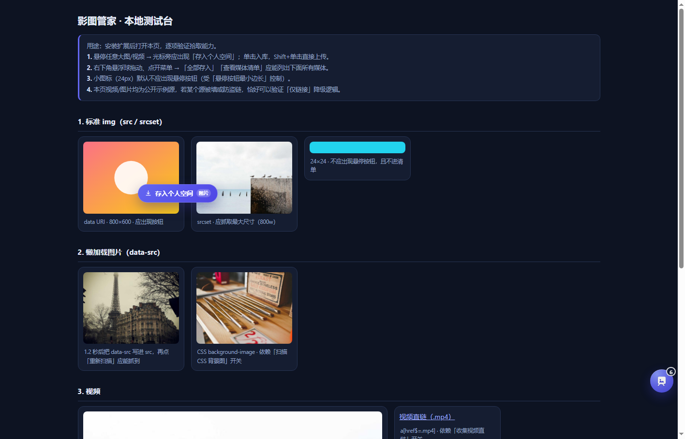

# 影图管家 MediaVault

一个用 Manifest V3 写的浏览器扩展：在任意网页上自动发现图片和视频，鼠标悬停即可一键存入「个人空间」；个人空间可作为图床/网盘/视频站的上传起点，支持 GitHub 仓库、S3 兼容对象存储（Cloudflare R2 / MinIO / 阿里云 OSS / 七牛）、WebDAV 网盘（坚果云 / Nextcloud / Alist）、Catbox、Pixeldrain、0x0.st、ImgBB、Imgur，以及任意返回 JSON 的 HTTP 图床。

> 仓库：<https://github.com/focklly/media-vault>
> 版本：v1.1.0 ｜ 浏览器：Chrome / Edge 116+



*实机截图：右下角渐变悬浮球（角标为扫描到的媒体数），鼠标悬停在图片上时出现「存入个人空间 · 图片」*

---

## 它解决什么问题

浏览网页时看到好图、好视频，传统做法是「右键 → 另存为 → 找文件夹 → 改名 → 再上传到某个图床」。这个扩展把这条链路压成一步：

1. 页面加载后自动扫描可下载的图片/视频（含懒加载、背景图、og:image、视频直链、m3u8 播放地址）。
2. 鼠标悬停到媒体上，光标旁出现「存入个人空间」按钮。
3. 点击后原文件抓取进本地个人空间（IndexedDB），可选同步到你外接的图床 / 网盘 / S3。
4. 在「个人空间」页统一管理：搜索、筛选、预览、批量上传、复制外链、导出、删除。

**本地优先**：即使一个外部站点都没配置，扩展也能完整使用——所有媒体存在本机，不依赖任何第三方服务。

---

## 功能一览

| 模块 | 能力 |
| --- | --- |
| 页面拾取 | 悬浮球（可拖动、位置记忆）、悬停按钮、右键菜单、`Shift+单击` 直接上传 |
| 自动扫描 | `` / `srcset` / `<picture>` / CSS 背景图 / 懒加载属性 / `<video>` + `<source>` / `a[href=mp4]` / `og:image` / `og:video` |
| 个人空间 | 网格图库、类型/状态筛选、全文搜索、四档排序、预览弹窗、收藏、批量上传/删除/导出、清单 JSON 备份 |
| 存储适配器 | GitHub 仓库、S3 兼容（SigV4 直传）、WebDAV、通用 HTTP 图床，以及 Catbox / Pixeldrain / 0x0.st / ImgBB / Imgur 免费站点；配置项自动渲染、连接测试 |
| 多站点调度 | 多站点同时启用；可分别为图片、视频设置默认站点，并设全局兜底站点 |
| 跨站转存 | 条目在站点间互相转存，保留转存历史 |
| 标签管理 | 图片/视频打标签，支持按标签搜索与标签快捷筛选 |
| 站点角标 | 图库缩略图显示所属站点角标 |
| 工程能力 | 免构建（改完刷新即生效）、ES Module 后台、Shadow DOM 隔离、统一消息协议、完整文档与交接文档 |

---

## 安装（开发者模式）

1. 下载或克隆本仓库：

   ```bash
   git clone https://github.com/focklly/media-vault.git
   ```

2. 打开 `chrome://extensions`（Edge 为 `edge://extensions`），右上角开启「开发者模式」。
3. 点「加载已解压的扩展程序」，选择仓库根目录（能看到 `manifest.json` 的那一层）。
4. 首次安装会自动打开设置页；不配置任何上传目标也能直接使用。
5. 打开 `tools/testbed.html` 验证拾取效果（本地文件可直接用 `file://` 打开，但需在扩展详情里允许「文件网址」）。

---

## 快速上手

1. **悬停拾取**：任意网页把鼠标移到图片上 → 点「存入个人空间」。视频同理。
2. **批量**：点右下角悬浮球 → 「全部存入个人空间」，或「查看媒体清单」逐个挑。
3. **管理**：扩展图标 → 「打开图库 →」，或悬浮球菜单 → 「打开个人空间」。
4. **外接存储**：设置 → 上传目标 → 选一个站点填配置 → 「测试连接」→ 打开「入库后自动上传」。详细步骤见 [docs/ADAPTERS.md](docs/ADAPTERS.md)。

### 适配器选型建议

| 需求 | 推荐 | 原因 |
| --- | --- | --- |
| 只想零成本存图 | GitHub 仓库 | 免费、有版本历史、raw 链接可直接当图床（单文件 ≤ 40MB） |
| 存视频、流量大 | Cloudflare R2 | 免费 10GB 存储 + 出网流量不计费，S3 兼容 |
| 想接百度网盘/阿里云盘/夸克 | Alist + WebDAV | Alist 把这些网盘挂载成本地 WebDAV，扩展直接写 |
| 已有自建图床 | 通用 HTTP 图床 | 填 URL、字段名、返回 JSON 路径即可，无需改代码 |

### 免费站点一览

| 站点 | 支持类型 | 免费额度 | 是否需注册 |
| --- | --- | --- | --- |
| Catbox | 图片 + 视频 | 单文件 ≤200MB，永久保留 | 否（用户哈希可选） |
| Pixeldrain | 图片 + 视频 | 单文件 ≤20GB，至少保留约两个月 | 可选（API Key 可选） |
| 0x0.st | 图片 + 视频 | 单文件 ≤512MB，保留期约 30–365 天 | 否 |
| ImgBB | 仅图片 | 单图 ≤32MB | 是（API Key 必填；API 可能需 Pro） |
| Imgur | 图片 / GIF / mp4 | 单文件约 ≤200MB，视频 ≤60s | 是（Client-ID 必填） |

---

## 目录结构

```text
media-vault/
├── manifest.json                 # MV3 清单：权限、入口、图标
├── src/
│   ├── background/
│   │   ├── service-worker.js     # 消息路由、抓取、落库、上传、右键菜单、角标
│   │   └── adapters/
│   │       ├── index.js          # 适配器注册表（新增存储只改这里一行）
│   │       ├── github.js         # Contents API 图床
│   │       ├── s3.js             # SigV4 直传（R2/MinIO/OSS/七牛/B2）
│   │       ├── webdav.js         # 坚果云/Alist/Nextcloud/群晖
│   │       └── http.js           # 通用 multipart 图床
│   ├── content/
│   │   └── content.js            # 单文件 IIFE：扫描、悬停按钮、悬浮球、清单面板
│   ├── popup/                    # 工具栏弹窗：本页统计 + 快捷开关
│   ├── library/                  # 个人空间：网格图库、预览、批量操作
│   ├── settings/                 # 设置页：通用/上传目标/拾取规则/数据/关于
│   ├── shared/                   # 常量、工具、IndexedDB、设置、消息通道
│   └── icons/                    # 由 tools/make-icons.mjs 生成
├── docs/                         # 架构、开发指南、适配器手册、交接文档、隐私说明
├── tools/
│   ├── make-icons.mjs            # 纯 Node 生成 PNG 图标
│   ├── testbed.html              # 手动测试页
│   ├── check.ps1                 # 一键校验（语法/manifest/图标）
│   └── pack.ps1                  # 打包商店 zip
├── .github/workflows/validate.yml
├── CHANGELOG.md
├── CONTRIBUTING.md
└── LICENSE (MIT)
```

---

## 文档索引

| 文档 | 内容 |
| --- | --- |
| [docs/ARCHITECTURE.md](docs/ARCHITECTURE.md) | 分层架构、上下文职责、消息协议、数据模型、导入/上传时序、关键设计决策 |
| [docs/DEVELOPER_GUIDE.md](docs/DEVELOPER_GUIDE.md) | 环境、调试、新增适配器完整模板、改扫描规则、编码规范、发布流程 |
| [docs/ADAPTERS.md](docs/ADAPTERS.md) | GitHub / R2 / WebDAV / Alist / SM.MS / 自建图床的逐步配置与排错 |
| [docs/HANDOVER.md](docs/HANDOVER.md) | **交接文档**：完成度、验证清单、已知限制、待办优先级、凭证管理、故障手册 |
| [docs/PRIVACY.md](docs/PRIVACY.md) | 权限用途、数据流向、密钥存储风险 |
| [docs/FAQ.md](docs/FAQ.md) | 常见问题（按钮不出现、上传失败、视频无法播放等） |

---

## 开发：免构建

本项目**不需要 `npm install`、不需要打包**，直接改源码 → 在 `chrome://extensions` 点扩展卡片上的刷新按钮 → 刷新网页即可。

- 后台是原生 ES Module（`"type": "module"`），可直接 `import`；
- 内容脚本是单文件 IIFE（MV3 的 content_scripts 不支持 module，原因与替代方案见开发指南）；
- 权限、入口都在 `manifest.json`，没有构建产物目录，仓库根目录就是可加载的扩展包。

校验与打包：

```powershell
pwsh tools/check.ps1     # 语法检查 + manifest 校验 + 图标存在性
pwsh tools/pack.ps1      # 产出 dist/media-vault-1.0.0.zip
```

---

## 权限说明（摘要）

| 权限 | 为什么需要 |
| --- | --- |
| `host_permissions: http/https` | 在任意页面注入悬浮球；跨域抓取原始图片/视频；访问你配置的图床/S3/WebDAV |
| `storage` + `unlimitedStorage` | 保存设置与个人空间媒体，避免几 GB 图库触发配额上限 |
| `contextMenus` | 右键图片/视频「存入影图管家」 |
| `notifications` | 入库/上传完成提示 |
| `tabs` / `scripting` | 打开个人空间、读取当前页标题、按需注入 |
| `downloads` | 从图库导出文件到本地 |

扩展不做任何统计上报，不含远程脚本，所有网络请求只发往你明确配置的站点与你正在浏览的页面。详见 [docs/PRIVACY.md](docs/PRIVACY.md)。

---

## 路线图（摘要）

- **P0**：上传失败自动重试、视频封面截帧、端到端自动化测试
- **P1**：HLS 下载（ffmpeg.wasm）、标签与相册、重复文件哈希去重、S3 分片上传
- **P2**：i18n、Firefox 适配、商店发布素材

完整优先级与验收标准见 [docs/HANDOVER.md](docs/HANDOVER.md#待办与优先级)。

---

## 贡献

见 [CONTRIBUTING.md](CONTRIBUTING.md)。改完功能请同步更新 `CHANGELOG.md` 并推送到 GitHub（流程见开发指南「发布与同步」）。

## 许可

[MIT](LICENSE) © 2026 focklly
